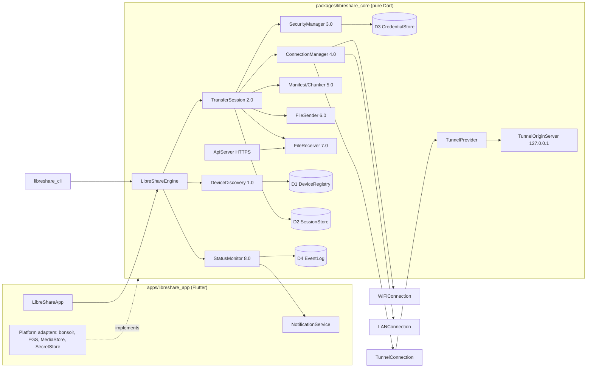
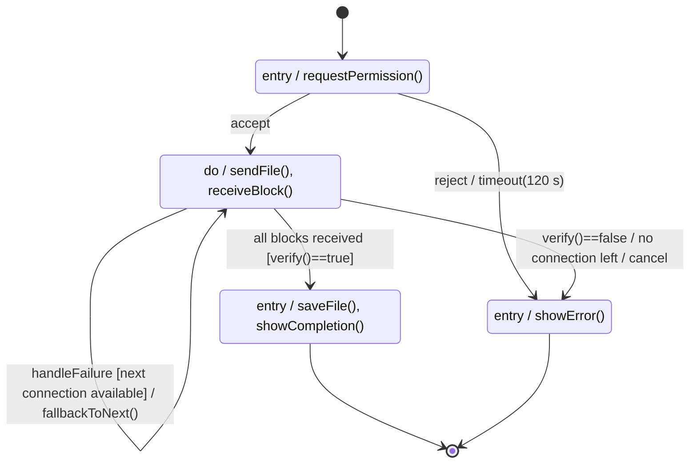

# LIBRESHARE_BUILD_SPEC.md — Build Specification for Claude Code

Build LibreShare as a **Flutter 3.47 / Dart 3.13 app on top of a GUI-free pure-Dart core package** that speaks a LocalSend-style protocol (UDP multicast + mDNS discovery, HTTPS REST over mutually authenticated self-signed TLS, SHA-256-verified 4 MiB resumable chunks) and falls back Wi-Fi path → other LAN paths → an end-to-end-encrypted Cloudflare Quick Tunnel, with zrok as backup. This is the only stack that ships Windows, Linux and Android in one semester and lets Claude Code test everything headlessly in a Linux container.

## TL;DR

- **Stack:** Flutter 3.47.x (Dart 3.13) UI; all networking, crypto, chunking and fallback in `packages/libreshare_core` (pure Dart, no Flutter imports) plus a `libreshare_cli` so two instances can transfer files on loopback/Docker networks in CI. LocalSend, the leading open-source AirDrop alternative, is built on Flutter.
- **Connection ladder:** WiFiConnection = direct peer path over the shared Wi-Fi (optional LibreShare hotspot); LANConnection = every other local address (Ethernet, second NIC, manual IP); TunnelConnection = sender-hosted, pre-warmed Cloudflare Quick Tunnel carrying AES-256-GCM ciphertext whose key travels in the URL fragment. True Wi-Fi Direct is impossible on macOS/iOS and a stretch goal elsewhere. [github](https://www.github.com/grishka/NearDrop)
- **Process:** five increments in six 2-week sprints; every FR/NFR traces to a module and an automated test; Claude Code works one increment at a time in plan mode, runs `dart test` after each step, guided by a ≤200-line CLAUDE.md. [github](https://github.com/shanraisshan/claude-code-best-practice/blob/main/CLAUDE.md)

---

## Key Findings

### 1. Prior art — what to copy

| Project | Architecture | LibreShare adopts / learns |
|---|---|---|
| **LocalSend** (Flutter) | UDP multicast on 224.0.0.167:53317 + HTTP(S) REST on TCP 53317; README now titled v2.2, most third-party implementations target v2.1; undocumented v3 WebRTC transport | Protocol shape where "only one party needs an HTTP server"; fingerprint = SHA-256 of cert; multicast group inside 224.0.0.0/24 "because some Android devices reject any other multicast group"; HTTP subnet-scan fallback; prepare-upload → upload → cancel; PIN | [github](https://github.com/localsend/protocol)
| **LocalSend internals** | v1.18 moved networking into Rust via `flutter_rust_bridge`; v1.11–v1.17 used pure-Dart `shelf`, `dio`, `basic_utils` | Pure Dart is enough to ship; Rust is a later optimisation | [github](https://github.com/localsend/localsend/blob/main/app/pubspec.yaml) [github](https://github.com/I-Want-ToBelieve/localsend/blob/main/pubspec.yaml)
| **Warpinator** | gRPC + Zeroconf; certs exchanged encrypted with a shared "group code" | Default code "Warpinator" made trust bypassable. CVE-2022-42725 (CVSS 3.1 7.5 HIGH, per NVD/GitHub Advisory) says Warpinator through 1.2.14 "allows access outside of an intended directory, as demonstrated by symbolic directory links" → no default secrets, sanitize every path and resolve symlinks |
| **croc** | PAKE code phrase; relay (local on LAN, public otherwise); blocks compressed+encrypted; recipient tracks blocks to resume | Chunk-bitmap resume; E2E encryption so relays see only ciphertext | [infinitedigits](https://infinitedigits.co/posts/croc/)
| **magic-wormhole** | SPAKE2 short codes, rendezvous + transit relay | Short-code UX (stretch); SAS instead of PAKE in MVP |
| **Syncthing** | Discovery servers, relays, SHA-256 block hashing | Per-chunk + whole-file SHA-256 |
| **Quick Share / NearDrop** | Google uses Wi-Fi Direct, hotspot, Bluetooth, WebRTC; NearDrop implements only Wi-Fi LAN, notes "Wi-Fi direct isn't supported on macOS", uses a QR code because macOS can't send the BLE broadcasts Android listens for [github](https://github.com/billylo1/NearDropAuto) | LAN-first is a viable product; QR fallback | [github](https://www.github.com/grishka/NearDrop)
| **AirDrop / AWDL** | AWDL "works on top of 802.11 itself … can not be implemented without messing around with the Wi-Fi adapter drivers" (NearDrop author) [github](https://github.com/billylo1/NearDropAuto) | Not attempted | [github](https://www.github.com/grishka/NearDrop)
| **PairDrop/Snapdrop** | Browser WebRTC + signaling (+TURN) | Out of MVP |

### 2. "WiFi vs LAN" — feasibility in 2026

- **Same-router LAN (Wi-Fi or Ethernet)** works everywhere with plain sockets; it is what LocalSend, NearDrop and Warpinator use. [androidcentral](https://www.androidcentral.com/apps-software/nearby-share-macos-unofficial) [github](https://github.com/linuxmint/warpinator)
- **Android:** `WifiP2pManager` and `LocalOnlyHotspot` work; apps targeting API 33+ need runtime `NEARBY_WIFI_DEVICES` (`neverForLocation`), `ACCESS_FINE_LOCATION` for API ≤32. A local-only hotspot "will not have Internet access", ideal for an ad-hoc link joined via Wi-Fi QR. [android](https://developer.android.com/guide/topics/connectivity/wifi-permissions) [android](https://developer.android.com/guide/topics/connectivity/localonlyhotspot)
- **Windows 10/11:** WinRT `WiFiDirectAdvertisementPublisher` with `LegacySettings` (Ssid/Passphrase) makes the PC "act as a normal Wi-Fi access point"; needs native C++/WinRT, the Proximity capability, and "only one app can be connected to a Wi-Fi Direct device at a time". Stretch. [microsoft](https://learn.microsoft.com/en-us/uwp/api/Windows.Devices.WiFiDirect?redirectedfrom=MSDN&view=winrt-22621) [microsoft](https://learn.microsoft.com/en-us/uwp/api/windows.devices.wifidirect.wifidirectlegacysettings?view=winrt-26100)
- **Linux:** `nmcli device wifi hotspot` works; wpa_supplicant P2P is driver-dependent. Stretch.
- **macOS/iOS:** no Wi-Fi Direct, AWDL private; can only join another device's hotspot. [github](https://github.com/billylo1/NearDropAuto)
- **Consequence:** model the ladder as ordered connection *candidates* (like ICE), not radio technologies.

### 3. Internet tunnel providers (Sept–Oct 2026)

| Provider | Free tier | Embeddable | Privacy | Verdict |
|---|---|---|---|---|
| **Cloudflare Quick Tunnel** | No account; docs: "no uptime guarantee", "up to 200 in-flight requests" (then 429), no SSE, new hostname each run, "for testing and development"; Free/Pro proxied bodies capped at 100 MB; URL may take ~30 s to resolve. An optional `--allowed-mail` gate, announced 2 Oct 2026, makes visitors "prove control of an allowed email address"; it is free and needs no account, but "does not support non-interactive clients" | Bundle/download Apache-2.0 `cloudflared`, parse URL from log | Cloudflare terminates TLS → app-layer E2E mandatory | **Primary** (desktop hosts) |
| **zrok** (OpenZiti, Apache 2.0) | zrok.io pricing, Free $0/month: "5 Daily GB · 25 Environments · 50 Share Backends (Ephemeral or Reserved) · 50 Private Access Frontends". Interstitial page until a credit card is verified. Public shares are limited to "2,000 requests per IP and 7,500 requests per share, each per 5-minute window", and exceeding the limit disables running shares (Global Nerdy, Sep 2026). Self-hosting is unlimited | CLI + Go SDK; account token | Operators can see public-share traffic → E2E [algolia](https://docsearch.algolia.com/mcp/docs/repo/openziti/zrok) | **Backup** |
| **ngrok** | 3 online endpoints, 1 GB transfer, 20k HTTP requests and a $5 one-time credit that can't be spent on data transfer (per Pinggy's 2026 ngrok-alternatives comparison); interstitial | SDKs, needs authtoken | TLS at ngrok | Reject |
| **Pinggy** | Free $0/month: "60 minutes tunnel timeout · Random subdomains · Unlimited Data Transfer" (Pinggy pricing as quoted by agentdeals.dev, 7 Oct 2026; secondary source) | SSH | TLS at relay | Manual fallback only |
| **Tailscale Funnel** | Relay forwards encrypted bytes | Needs Tailscale install + login | Best | Reject (not zero-config) | [flaviocopes](https://flaviocopes.com/cloudflare-quick-tunnels/)
| **frp / bore / croc relay on VPS** | Unlimited | Yes | You control | Documented team option |

### 4. Platform constraints

- **Android 15+:** Android Developers' behavior-change notes cover apps "targeting Android 15 (API level 35) or higher". There, "the system permits an app's dataSync services to run for a total of 6 hours in a 24-hour period, after which the system calls … Service.onTimeout(int, int)". A service that doesn't stop throws `ForegroundServiceDidNotStopInTimeException`. Starting a new one after the limit throws `ForegroundServiceStartNotAllowedException` ("Time limit already exhausted for foreground service type dataSync"). Foregrounding the app resets the timer.
- **iOS:** UDP multicast/broadcast needs the restricted `com.apple.developer.networking.multicast` entitlement (Apple approval, paid account); Bonjour browsing of declared types needs only Local Network permission → iOS is post-MVP, mDNS-only. [microsoft](https://learn.microsoft.com/en-us/answers/questions/461950/multicast-and-broadcast-entitlements-in-xamarin-io) [apple](https://developer.apple.com/forums/thread/663875)
- **macOS:** the multicast entitlement "is neither required nor supported", but the Local Network prompt applies. [apple](https://developer.apple.com/forums/thread/798399)

### 5. Stack choice

Flutter stable is **3.47.x / Dart 3.13** (3.47.9 / Dart 3.13.7 released 29 Oct 2026; 3.50 in beta). [flutterreleases](https://flutterreleases.com/flutter-versions/) [flutterreleases](https://flutterreleases.com/) Tauri 2 reached 2.12 (26 Sep 2026; Android 8+/iOS 15+) but mobile features still need custom Swift/Kotlin plugins and Rust skills. [github](https://github.com/orgs/tauri-apps/discussions/10197) [tech-insider](https://tech-insider.org/tauri-tutorial-cross-platform-rust-app-2026/) Flutter wins on Android maturity, LocalSend precedent, `dart:io` TLS/HTTP/UDP, and headless testability.

---

## Details — The Build Specification (instructions to Claude Code)

> **Claude Code: read this whole file first. Work in plan mode, one increment at a time. Never start increment N+1 until all acceptance tests of increment N pass in CI. Never modify acceptance tests to make them pass.**

### 0. Scope

| Scope | Included |
|---|---|
| **MVP platforms** | Linux x64, Windows 10/11 x64, Android 10+ (API 29+, target 35/36) |
| **MVP+** | macOS 12+ (unsigned DMG, built in CI) |
| **Stretch** | iOS (paid account + multicast entitlement; mDNS only) |
| **MVP features** | FR-01…FR-17: multicast + mDNS + subnet-scan + QR/manual discovery, identity, accept/reject, multi-file, 4 MiB chunks, per-chunk + whole-file SHA-256, resume, Wi-Fi→LAN→Tunnel fallback, mTLS + TOFU + SAS, notifications, history |
| **Stretch (NFR-08)** | Folders, hotspot mode, BLE discovery, browser download page, bandwidth limiter, fastest-channel probing, Rust core |

### 1. Tech stack (minimum versions verified on pub.dev Oct 2026; add with `flutter pub add`; ⚠ = verify)

| Concern | Choice | Version ≥ |
|---|---|---|
| SDK | Flutter / Dart (pin in `.fvmrc` + CI) | 3.47.9 / 3.13.7 |
| Monorepo | Dart pub workspaces | built-in |
| HTTPS server | `dart:io` `HttpServer.bindSecure` + `shelf` + `shelf_router` | 1.4.3 / 1.1.4 (stable, inactive) | [pub](https://pub.dev/packages/shelf) [pub](https://pub.dev/packages/shelf_router/versions)
| HTTP client | `dart:io` `HttpClient` (streaming, client certs) | SDK |
| UDP multicast | `dart:io` `RawDatagramSocket` | SDK |
| mDNS | `bonsoir` (Android NSD, Bonjour, Windows, Linux/Avahi) — app layer behind `MdnsBackend` | 7.1.5 [pub](https://pub.dev/packages/bonsoir) [pub](https://pub.dev/packages/bonsoir/versions/4.1.4) |
| Self-signed X.509 | `basic_utils` + `pointycastle` (ECDSA P-256) | 5.8.x ⚠ / 4.0.0 | [pub](https://pub.dev/packages/pointycastle) [github](https://github.com/Ephenodrom/Dart-Basic-Utils/blob/master/pubspec.yaml)
| Hashing | `crypto` SHA-256 (`hashlib` 2.4.2 has no BLAKE3) | 3.0.7 | [pub](https://pub.dev/documentation/blake3_ffi/1.2.2/)
| AEAD + HKDF | `cryptography` `AesGcm.with256bits()` | 2.9.0 | [pub](https://pub.dev/packages/cryptography/versions)
| State / routing | `flutter_riverpod` / `go_router` | 3.4.3 / 18.1.2 | [pub](https://pub.dev/packages/flutter_riverpod) [pub](https://pub.dev/packages/go_router/changelog)
| Files / paths | `file_picker` (11.0.3 on pub.dev page vs 13.3.0 via `pub outdated` 31 Oct 2026 ⚠) / `path_provider` | 13.3.0 ⚠ / 2.1.6 | [github](https://github.com/GargIT/Gargosy/issues/261) [pub](https://pub.dev/packages/file_picker/versions) [pub](https://pub.dev/packages/path_provider/versions)
| Permissions / notifications | `permission_handler` / `flutter_local_notifications` | 13.0.2 / 22.3.3 | [pub](https://pub.dev/packages/flutter_local_notifications/changelog) [pub](https://pub.dev/packages/permission_handler)
| Android FGS | `flutter_foreground_task` | 11.0.3 | [pub](https://pub.dev/packages/flutter_foreground_task)
| QR render / scan | `pretty_qr_code` (LocalSend's choice; `qr_flutter` 4.1.0 stale) / `mobile_scanner` | 3.6.0 / 7.4.2 | [github](https://github.com/localsend/localsend/blob/main/app/pubspec.yaml) [pub](https://pub.dev/packages/mobile_scanner/versions) [pub](https://pub.dev/packages/qr_flutter/versions)
| Interfaces / IDs / JSON | `network_info_plus` / `uuid` / `json_serializable` | 8.1.0 / 4.6.0 / 6.15.2 | [pub](https://pub.dev/packages/uuid) [pub](https://pub.dev/packages/json_serializable) [pub](https://pub.dev/packages/network_info_plus/versions)
| Persistence | atomic JSON files + JSONL log (no native DB in core) | SDK |
| Secret key storage | `flutter_secure_storage` behind `SecretStore` | latest ⚠ |
| Tunnel | `cloudflared` binary (primary), `zrok` (backup), SHA-256-pinned | 2026.9.x+ |
| Tests / lints | `test`, `mocktail`, `flutter_test`, `integration_test`, `lints` | latest |

#### 1.1 Stack comparison

| Option | Platform coverage | Low-level net | Android FGS/storage | Team ramp | Headless tests | Verdict |
|---|---|---|---|---|---|---|
| **Flutter** | Win/Linux/mac/Android/iOS | `dart:io` sockets, client certs | Mature plugins | Medium (Dart ≈ Java/TS) | `dart test`, `flutter test`, `xvfb-run` | **Primary** |
| Tauri 2 (Rust + React) | All five | Excellent (tokio, rustls, quinn) | Custom Kotlin plugins [tauri](https://v2.tauri.app/blog/tauri-2-0-0-alpha-4/) | Slow (Rust) | `cargo test` | **Alternative** |
| Electron + React | Desktop only | Good | None | Fast | Good | Reject (no Android) |
| Compose Multiplatform | Desktop + Android, iOS maturing | JVM/ktor | Native | Good for Java devs | Gradle | 2nd alternative |
| .NET MAUI / Avalonia | MAUI lacks Linux; Avalonia mobile young | Good | Partial | Medium | Good | Reject |
| React Native | Mobile; no Linux | Native modules | Good | Fast | Partial | Reject |
| Go (Wails/Fyne) | Fyne all, weak mobile UX | Excellent | Partial | Medium | `go test` | Core option only |
| Python (PySide6/Kivy/Flet) | Desktop good, Android fragile | asyncio | Painful | Fastest | pytest | Prototype only |
| Rust/Go core + native UIs | All | Excellent | Good | 2–4 UIs | Good | Reject for a semester |

### 2. Architecture

#### 2.1 Component diagram



#### 2.2 Transfer + fallback sequence

```mermaid
sequenceDiagram
  participant S as Sender
  participant R as Receiver
  participant U as Receiver user
  S->>R: UDP announce / mDNS (1.0)
  S->>R: POST /api/v1/sessions (mTLS, manifest, tunnelOffer)
  R->>U: showPermissionPrompt(files, SAS)
  S->>R: GET /sessions/{id}?wait=25 (long-poll)
  U-->>R: accept
  R-->>S: 200 {fileTokens, receivedRanges}
  loop chunks via WiFiConnection
    S->>R: PUT /files/{fid}/chunks/{i} + X-LS-Chunk-SHA256
    R-->>S: 200 ack
  end
  Note over S,R: 3 consecutive failures
  S->>S: handleFailure() -> fallbackToNext() -> LANConnection
  S->>R: GET /files/{fid}/state, PUT missing chunks
  Note over S,R: all local paths fail
  S->>S: fallbackToNext() -> TunnelConnection (pre-warmed)
  R->>S: GET tunnel /t/{tok}/f/{fid}/c/{i} (ciphertext) + POST ack
  R->>R: verify() whole-file SHA-256, saveFile()
  R-->>S: final ack; both showCompletion()
```

#### 2.3 TransferSession state machine (matches UML)



`TransferStatus` keeps exactly the four UML values; causes go in `FailureReason` {REJECTED, TIMEOUT, CANCELLED, VERIFY_FAILED, NO_CONNECTION, DISK_FULL, PROTOCOL_ERROR}.

### 3. Module map (paths under `packages/libreshare_core/lib/src/` unless noted)

| UML class / DFD | Files | Responsibility |
|---|---|---|
| LibreShareApp | `apps/libreshare_app/lib/app.dart`; core `engine/libreshare_engine.dart` | start, showDevices, selectFiles, showStatus |
| Device | `model/device.dart` | deviceId, name, ipAddress candidates, platform, fingerprint; getInfo |
| DeviceDiscovery **1.0** | `discovery/{device_discovery,multicast_discovery,mdns_discovery,subnet_scanner,manual_peer}.dart` | discoverDevices, identifyDevice |
| TransferSession **2.0** | `session/{transfer_session,transfer_status,failure_reason}.dart` | requestPermission, accept, reject, start, handleFailure |
| SecurityManager **3.0** | `security/{security_manager,cert_factory,trust_store,sas,tunnel_crypto,rate_limiter}.dart` | authenticate, encrypt, decrypt |
| ConnectionManager **4.0** | `connection/{connection_manager,candidate}.dart` | connect, fallbackToNext, disconnect; publish active channel |
| Connection + subclasses | `connection/{connection,wifi_connection,lan_connection,tunnel_connection}.dart`; `tunnel/{tunnel_provider,cloudflared_provider,zrok_provider,fake_tunnel_provider}.dart` | establish, send(block), receive, close; tunnelUrl |
| FileItem **5.0** | `transfer/{file_item,manifest,chunker}.dart` | fileName, fileSize, checksum; split |
| FileSender **6.0** | `transfer/file_sender.dart` | splitIntoBlocks, sendFile, queue, acks |
| FileReceiver **7.0** | `transfer/{file_receiver,resume_store,filename_sanitizer}.dart` | receiveBlock, reconstruct, verify, saveFile |
| NotificationService | `apps/.../services/notification_service.dart` (core emits `Stream<LsEvent>`) | prompts, progress, completion |
| **8.0** | `monitor/{status_monitor,events}.dart` | classify, recover, notify |
| **D1–D4** | `storage/device_registry.dart` (devices.json), `session_store.dart` (sessions/*.json), `credential_store.dart` (cert + SecretStore), `event_log.dart` (events.jsonl) | data stores |
| HTTP | `server/api_server.dart`, `server/tunnel_origin_server.dart`, `client/api_client.dart` | protocol |

### 4. Wire protocol — LSP/1

#### 4.1 Defaults

| Item | Value |
|---|---|
| Multicast | `224.0.0.168` UDP `53318` (in 224.0.0.0/24 for Android; avoids LocalSend's .167:53317) | [github](https://github.com/localsend/protocol)
| HTTPS API | TCP `53318`, fallback 53319–53327 (actual port announced) |
| mDNS | `_libreshare._tcp`, TXT `id`, `fp` (16 hex), `v`, `pf` |
| TLS | TLS 1.3, mutual auth, self-signed ECDSA P-256 |
| Fingerprint | uppercase hex SHA-256 of DER cert |
| Chunk | 4 MiB (4,194,304 B) |

#### 4.2 Discovery announce (UDP JSON ≤1200 B)

```json
{"proto":"libreshare","v":"1.0","deviceId":"uuid-v4","alias":"Ravi-ThinkPad",
 "platform":"windows","deviceType":"desktop","fingerprint":"64 hex","port":53318,
 "addrs":[{"ip":"192.168.1.23","if":"wifi"},{"ip":"10.0.0.5","if":"ethernet"}],
 "caps":["resume","tunnel","sas"],"announce":true}
```

- Announce at start, +1 s, +3 s, every 30 s and on interface change; expire peers after 90 s.
- On `announce:true` from a foreign fingerprint: reply `POST https://<ip>:<port>/api/v1/register` (DeviceInfo); if it fails in 2 s, reply UDP unicast `announce:false`.
- Drop unknown major `v`, bad JSON, >1200 B; rate-limit 20 packets/s per IP.
- **Subnet scan:** after 5 s with no peers or on demand, `GET /api/v1/info` across each local /24 (skip >/22), 64 concurrent, 800 ms timeout.
- **QR/manual:** `libreshare://peer?ip=…&port=53318&fp=<64hex>&id=<uuid>&n=<alias>`; manual IP shows fingerprint for confirmation. Handles AP/client isolation.

#### 4.3 REST endpoints (`https://<host>:<port>/api/v1`, mTLS)

| Method & path | Purpose | Success | Errors |
|---|---|---|---|
| `GET /info` | identify | DeviceInfo | — |
| `POST /register` | two-way discovery | DeviceInfo | 400 |
| `POST /sessions` | permission request (FR-05/06/07) | 202 `{sessionId,status:"PENDING"}` or 200 if trusted auto-accept | 401 PIN_REQUIRED/PIN_INVALID, 403 BLOCKED, 409 BUSY, 413 TOO_LARGE, 429 RATE_LIMITED, 507 INSUFFICIENT_STORAGE |
| `GET /sessions/{sid}?wait=25` | long-poll status | SessionStatus | 404, 410 CANCELLED |
| `GET /sessions/{sid}/files/{fid}/state` | resume bitmap | `{receivedRanges:[[0,41]],chunkCount}` | 404 |
| `PUT /sessions/{sid}/files/{fid}/chunks/{idx}` | chunk (FR-08); `Authorization: Bearer <fileToken>`, `X-LS-Chunk-SHA256` | 200 `{ack}` (idempotent) | 401 TOKEN_INVALID, 409 WRONG_STATE, 416 OUT_OF_RANGE, 422 CHUNK_HASH_MISMATCH |
| `POST …/files/{fid}/complete` | verify (FR-09/10) | 200 `{verified,sha256}` | 422 VERIFY_FAILED, 409 MISSING_CHUNKS |
| `POST /sessions/{sid}/finish` | close (FR-11) | 200 COMPLETED | 409 |
| `POST /sessions/{sid}/cancel` | cancel | 200 | 404 |

```json
// SessionRequest
{"sender":{"...":"DeviceInfo"},"pin":"123456","chunkSize":4194304,
 "files":[{"fileId":"f1","fileName":"report.pdf","relativePath":null,"size":5242880000,
   "mime":"application/pdf","sha256":"64 hex or null","chunkCount":1250,"modified":"2026-10-30T10:00:00Z"}],
 "totalSize":5242880000,
 "tunnelOffer":{"provider":"cloudflare-quick","url":"https://x.trycloudflare.com/t/<token>",
   "keyB64":"<32 bytes b64url>","expiresAt":"2026-11-02T12:30:00Z"}}
// SessionStatus
{"sessionId":"uuid","status":"PENDING|IN_PROGRESS|COMPLETED|FAILED","failureReason":null,
 "acceptedFiles":{"f1":{"token":"b64url-128bit","receivedRanges":[]}}}
// Error envelope
{"error":{"code":"CHUNK_HASH_MISMATCH","message":"…","retryable":true}}
```

`tunnelOffer` travels only inside mTLS, so the provider never learns the key. Whole-file SHA-256 is computed in a background isolate; for files >2 GiB send `sha256:null` and supply it in the `/complete` body. Schemas live in `docs/protocol/schemas/`.

#### 4.4 Chunking, acks, resume, cancel

- Chunk `i` = bytes `[i*chunkSize, min((i+1)*chunkSize, size))`; 64-bit offsets (files >4 GB OK). Receiver writes via `RandomAccessFile.setPosition` into `<name>.lspart`, bitmap in D2 flushed every 8 chunks.
- Concurrency: 2 files × 3 chunks on LAN; 4 total on tunnel (well under the 200 cap). Stream from `file.openRead(start,end)`; memory ≤ inFlight × chunkSize.
- Ack = HTTP 200; retries 3 per chunk (0.5/1/2 s). After any reconnect/channel switch, sender calls `/state` and sends only missing chunks. Sessions resumable 24 h.
- Cancel: `/cancel` → peer gets 410 → FAILED(CANCELLED); partials deleted unless "keep partial files".

#### 4.5 Tunnel origin API (sender, HTTP on 127.0.0.1:<random>, reachable only via tunnel)

| Route | Response |
|---|---|
| `GET /t/{token}/manifest` | AES-GCM sealed manifest |
| `GET /t/{token}/f/{fid}/c/{idx}` | `nonce(12) ‖ ciphertext ‖ tag(16)` |
| `POST /t/{token}/ack` | sealed `{fid,idx}` or `{final:true,verified:true}` |
| `GET /t/{token}/healthz` | 204 (DNS-race detection) |

Link: `https://<host>/t/<token>#k=<key b64url>&s=<sessionId>&fp=<16 hex>` — the fragment never leaves the client. Token: 128-bit random, constant-time check, expires at COMPLETED, 30 min idle or 24 h, revoked after final ack.

#### 4.6 Versioning

`v` = major.minor; path carries major (`/api/v1`); unknown fields ignored; incompatible major → `426 UPGRADE_REQUIRED {supported:["1"]}`. Protocol changes must update `docs/protocol/LSP-1.md`, schemas and conformance tests in the same PR.

### 5. Security design and threat model (FR-16, NFR-04)

| Mechanism | Algorithm |
|---|---|
| Identity | ECDSA P-256 key generated on first run; self-signed X.509 (CN=deviceId, 10 y); key in OS secure storage (0600 file for CLI/tests) |
| Transport | Mutual TLS: server `requestClientCertificate: true`; both sides pin peer fingerprint in `badCertificateCallback` |
| First contact | SAS = `int(SHA-256("LSP1-SAS" ‖ min(fpA,fpB) ‖ max(fpA,fpB))[0..4]) mod 10^6`, 6 digits on both screens; "Trust this device" pins fingerprint (TOFU, D1/D3); QR pairing skips SAS |
| PIN (optional) | 6 digits, constant-time compare; 5 failures/IP → 10-min block |
| Consent | Non-trusted senders always prompt; trusted auto-accept is opt-in; 120 s timeout |
| Tunnel E2E | AES-256-GCM, per-session 32-byte key; nonce = 4-byte fileIndex ‖ 8-byte chunkIndex; AAD = sessionId‖fileId‖idx; manifest nonce `0xFFFFFFFF‖0`; origin binds 127.0.0.1 and serves only `/t/` |
| Rate limits | Per IP: 10 `POST /sessions`/min, 3 pending prompts, 20 discovery packets/s |
| Input limits | JSON ≤256 KiB; ≤10,000 files; sizes ≥0 summing to totalSize; writes past declared size → 416 |

**Filename sanitization** (`filename_sanitizer.dart`, fuzz-tested): NFC-normalize; split `relativePath` on `/` and `\`, drop empty/`.` segments and reject any `..`; strip control chars and `<>:"/\|?*`, trailing dots/spaces; prefix Windows reserved names (CON, PRN, AUX, NUL, COM1–9, LPT1–9) with `_`; truncate to 255 UTF-8 bytes keeping extension; canonicalize and **assert the path is inside the download dir**; collisions → `name (1).ext`.

| Threat | Mitigation | Test |
|---|---|---|
| Rogue device spamming | Consent, rate limits, block list, PIN | `rate_limit_test.dart` |
| MITM / ARP spoof | mTLS + pinning, SAS, QR | `mitm_test.dart` |
| Unauthorized download | No LAN download API; 128-bit token + fragment key; revocation | `token_test.dart` |
| Tunnel provider snooping | App-layer AES-256-GCM | `e2e_ciphertext_test.dart` |
| Path traversal (cf. CVE-2022-42725) | Sanitizer + prefix assertion | `sanitizer_fuzz_test.dart` |
| Disk exhaustion | Free space ≥ totalSize + 64 MiB before accept; no auto-decompression | `oversize_test.dart` |
| Corruption | Per-chunk 422 + resend; whole-file hash before rename | `corruption_test.dart` |
| Replay | Random session IDs, token binding, state checks | `state_machine_test.dart` |

### 6. Connection ladder and fallback (FR-12/13/14/15)

| Tier | Class | Reality | Candidates |
|---|---|---|---|
| 1 | **WiFiConnection** | Direct mTLS HTTPS over the shared WLAN; stretch sub-mode: LibreShare hotspot (Android LocalOnlyHotspot, Windows LegacySettings SoftAP, Linux nmcli) | peer `addrs` with `if:"wifi"`, hotspot gateway |
| 2 | **LANConnection** | Ethernet, second NIC, other private subnet, IPv6 link-local, manual/QR address | remaining addrs + manual |
| 3 | **TunnelConnection** | Sender-hosted E2E HTTPS via Cloudflare Quick Tunnel (zrok fallback); receiver pulls | `tunnelOffer.url` |

**Pre-warming:** for desktop senders with sessions >50 MB ("Prepare internet fallback", default on), start the tunnel in parallel with the permission request and send it in `tunnelOffer`. Otherwise the UI offers "Local connection lost — share this link/QR"; opening it resumes the same session from its bitmap.

| Parameter | Value |
|---|---|
| Connect per candidate | 3 s; same-tier candidates raced ("happy eyeballs") |
| TLS handshake | 5 s |
| Chunk idle timeout | 30 s LAN / 60 s tunnel |
| Channel failed | 3 consecutive chunk failures, or ECONNREFUSED/EHOSTUNREACH/ENETUNREACH, or `GET /info` fails twice in 4 s |
| Tunnel readiness | poll `/healthz` every 2 s up to 45 s |
| Upgrade probe (stretch) | every 30 s while on tier ≥2 |
| Give-up | no tier healthy 120 s → FAILED(NO_CONNECTION), state kept 24 h |

```dart
class ConnectionManager {
  final List<ConnectionFactory> ladder; // [WiFi, LAN, Tunnel]
  int _tier = -1;
  Connection? activeConnection;
  final StreamController<ChannelEvent> _events; // DFD 4.0 "publish active channel"

  Future<Connection> connect(Device peer, SessionContext ctx) async {
    for (var t = 0; t < ladder.length; t++) {
      final c = await _tryTier(t, peer, ctx);
      if (c != null) return _activate(t, c);
    }
    throw NoConnectionLeft();
  }

  /// Called by TransferSession.handleFailure().
  Future<Connection?> fallbackToNext(Device peer, SessionContext ctx, Object cause) async {
    _events.add(ChannelFailed(_tier, cause));
    await activeConnection?.close();
    for (var t = _tier + 1; t < ladder.length; t++) {
      if (!ladder[t].isAvailable(peer, ctx)) continue; // e.g. no tunnelOffer
      final c = await _tryTier(t, peer, ctx);
      if (c != null) {
        final active = _activate(t, c);
        await ctx.resyncResumeState(active); // GET .../state or tunnel manifest
        return active;
      }
    }
    activeConnection = null;
    return null; // -> FAILED(NO_CONNECTION)
  }

  Future<Connection?> _tryTier(int t, Device peer, SessionContext ctx) {
    final cands = ladder[t].candidates(peer, ctx);
    if (cands.isEmpty) return Future.value(null);
    return firstSuccessful(cands.map((c) => ladder[t].create(c).establish()),
        timeout: const Duration(seconds: 8));
  }

  Connection _activate(int t, Connection c) {
    _tier = t; activeConnection = c; _events.add(ChannelActive(t, c.kind)); return c;
  }

  Future<void> disconnect() async { await activeConnection?.close(); activeConnection = null; }
}
```

`TransferSession.handleFailure(e)`: (1) log to D4 and classify chunk-retryable vs channel failure; (2) on channel failure call `fallbackToNext` — non-null keeps IN_PROGRESS (self-transition), null → FAILED(NO_CONNECTION); (3) emit UI events.

### 7. Tunnel fallback design (FR-14)

1. **Abstraction:** `TunnelProvider.open(localPort) → TunnelHandle {publicUrl, close(), logs}`.
2. **CloudflaredProvider (primary):** download the official release to `<appSupport>/bin/`, verify against pinned SHA-256s in `cloudflared_versions.dart` (Cloudflare supports releases within one year — refresh pins each semester). [go](https://pkg.go.dev/github.com/cloudflare/cloudflared@v0.0.0-20260608181609-57f7d693bb76) Run `cloudflared tunnel --no-autoupdate --url http://127.0.0.1:<port>` with a clean HOME (quick tunnels fail if `~/.cloudflared/config.yml` exists). [github](https://github.com/cloudflare/cloudflare-docs/issues/28227) Parse `https://[a-z0-9-]+\.trycloudflare\.com` from stderr, then await `/healthz`. All requests ≤4 MiB GETs (below the 100 MB body cap), ≤4 in flight, no SSE. On process exit or "Unregistered tunnel connection", emit `TunnelLost` and restart once; on 429/1015 back off 10 s/30 s then switch to zrok. [github](https://github.com/splatterfacegames/godot-phone-mass-controllers/issues/3)
3. **ZrokProvider (backup):** user pastes a free zrok token once; run `zrok share public 127.0.0.1:<port> --headless`, parse URL; respect 5 GB/day. [github](https://github.com/openziti/zrok)
4. **Android as tunnel host:** not in MVP (no official Android cloudflared); Android receives tunnel links fine. Stretch: linux-arm64 binary in native-lib dir or the unofficial Rust `cloudflare-quick-tunnel` crate via FFI. [docs](https://docs.rs/crate/cloudflare-quick-tunnel/0.3.1/source/src/api.rs)
5. **Sharing:** QR + Copy Link; `libreshare://` deep link or "Receive from link"; countdown for 30 min idle / 24 h expiry; stopping the session kills `cloudflared`.
6. **Terms notice in Settings:** Quick Tunnels are "for testing and development" without SLA; use only for user-initiated, short-lived transfers; teams needing reliability should self-host zrok/frp. [cloudflare](https://developers.cloudflare.com/tunnel/get-started/quick-tunnels/)

### 8. File handling

| Topic | Rule |
|---|---|
| Manifest | fileId, sanitized fileName, relativePath (folders stretch), size, mime, sha256, chunkCount, modified |
| Hashing | SHA-256 streamed in an `Isolate`, pipelined with sending; benchmark it |
| Resume | `.lspart` + D2 bitmap, 24 h; validate size + sha256 + modified |
| Location | Desktop `~/Downloads/LibreShare/` (configurable). Android: `.lspart` in app-specific storage, then copy to public Downloads/LibreShare via MediaStore (Kotlin method channel, API 29+) |
| Atomic save | `.lspart` → verify → rename → set mtime → FileSaved event |
| Large files | 64-bit offsets; warn on FAT32 targets for >4 GiB |
| Multiple files | One session, smallest first |

### 9. UI screens (Material 3, Riverpod)

1. **Home / Nearby:** device cards (alias, platform icon, IP, trust badge, last-seen); FAB **Send files**; actions Scan network, **Add device** (IP/QR), **My QR**; empty state explains AP isolation and suggests QR/IP or Internet link.
2. **Send:** pick files → choose device → waiting screen with 6-digit SAS → progress.
3. **Incoming prompt:** notification + full-screen dialog: sender, platform, IP, SAS, file list/total, **Accept / Reject**, "Trust this device"; auto-reject at 120 s.
4. **Progress:** per-file and overall bars, MB/s, ETA, live channel badge (**Wi-Fi / LAN / Internet**) with "Switched to LAN — resuming" toast; Cancel; Android ongoing notification.
5. **Completion (FR-11):** both devices; Open / Show in folder.
6. **History:** from D4 — direction, peer, files, size, result, channel, duration.
7. **Settings:** name, folder, port, PIN, auto-accept trusted, keep partials, internet fallback (Cloudflare/zrok/off), zrok token, trusted devices, own fingerprint.
8. **QR pairing:** show/scan `libreshare://peer?...` (`mobile_scanner`); desktops without cameras use manual entry + fingerprint confirmation.
9. **Receive from link:** paste/scan tunnel link → confirm fingerprint prefix → download.

### 10. Repository layout and conventions

```
libreshare/
├── CLAUDE.md  README.md  pubspec.yaml (workspace)  .fvmrc  analysis_options.yaml
├── docs/ LIBRESHARE_BUILD_SPEC.md, protocol/{LSP-1.md,schemas/}, traceability.md, adr/, plans/, test-reports/
├── packages/
│   ├── libreshare_core/ lib/src/{model,discovery,session,security,connection,tunnel,transfer,server,client,storage,monitor,engine}/  test/{unit,conformance,integration}/
│   └── libreshare_cli/bin/ls.dart        # info | devices | receive | send | link
├── apps/libreshare_app/ lib/{app.dart,screens,widgets,providers,services,platform}/  integration_test/
├── tools/ docker/{Dockerfile,compose.yaml}  netem/{cut_wifi.sh,restore.sh}  bench/bench_lan.sh
├── installer/ windows/libreshare.iss  linux/{AppImageBuilder.yml,deb/}
└── .github/workflows/{ci.yml,release.yml}
```

Conventions: `dart format`, `dart analyze --fatal-infos` clean; core never imports Flutter (CI grep); all I/O behind interfaces (`Clock`, `FileSystem`, `SecretStore`, `MdnsBackend`, `TunnelProvider`); typed `LsException` codes = protocol codes; `package:logging`, no `print`; Conventional Commits; branches `feat/inc<N>-<topic>`, PR + green CI to merge.

### 11. CLAUDE.md template (repo root, ≤200 lines)

```markdown
# LibreShare — Claude Code guide
P2P file sharing: Flutter UI + pure-Dart core. Spec: docs/LIBRESHARE_BUILD_SPEC.md. Protocol: docs/protocol/LSP-1.md.

## Rules
- ONE increment at a time (spec §12). Plan mode first; write docs/plans/inc<N>.md; wait for approval.
- Tests first, then code. NEVER edit acceptance tests to pass — ask.
- packages/libreshare_core must not import Flutter; platform code lives in apps/libreshare_app/lib/platform/.
- Protocol change => update LSP-1.md + schemas + conformance tests together.
- TransferStatus = {PENDING, IN_PROGRESS, COMPLETED, FAILED}; causes in FailureReason.
- Never log file contents, keys, PINs or tunnel URL fragments.

## Commands
- `dart pub get` (root) · `cd packages/libreshare_core && dart test` · `dart test test/unit/chunker_test.dart -N "last chunk"`
- `dart analyze --fatal-infos && dart format --set-exit-if-changed .`
- Loopback: `dart run packages/libreshare_cli/bin/ls.dart receive --port 53400 --dir /tmp/rx --auto-accept &` then `... send --to 127.0.0.1:53400 --insecure-tofu file.bin`
- E2E: `docker compose -f tools/docker/compose.yaml up --build --abort-on-container-exit`
- App: `cd apps/libreshare_app && flutter test` · `xvfb-run -a flutter test integration_test -d linux`
- Build: `flutter build linux|windows|macos|apk --release`

## Map
discovery 1.0 · session 2.0 · security 3.0 · connection 4.0 · transfer 5.0–7.0 · monitor 8.0
storage: D1 device_registry, D2 session_store, D3 credential_store, D4 event_log. UI/CLI use only engine/libreshare_engine.dart.

## Gotchas
- No GUI/Wi-Fi radio here: test via CLI + Docker networks; never test Wi-Fi Direct/hotspot in the container.
- Docker multicast needs a user-defined bridge network.
- Tunnel tests use FakeTunnelProvider unless LS_TUNNEL_LIVE=1.
- Android: hold MulticastLock while discovering; dataSync FGS must handle onTimeout.
```

### 12. Implementation plan (6 sprints × 2 weeks)

Per increment: plan mode → `docs/plans/inc<N>.md` → failing tests → implement → `dart analyze` + `dart test` (+ `flutter test`) → update `docs/traceability.md` → commit → PR.

**Increment 1 (Sprint 1) — Basic transfer.** Tasks: workspace + CI skeleton; models; chunker; `ApiServer` (HTTP first, behind an interface), `ApiClient`, `FileSender`, `FileReceiver` (`.lspart` + rename + whole-file SHA-256); CLI send/receive by address. Command: loopback transfer of a 100 MiB random file, then `cmp`. Acceptance: FR-07 multiple files; FR-08 correct chunk counts for sizes 0, 1, chunkSize−1, chunkSize, chunkSize+1, 5 GiB sparse; FR-09/10 byte-identical with matching SHA-256; FR-11 success printed on both sides; FR-17 A→B then B→A.

**Increment 2 (Sprint 2) — Discovery + cross-platform.** Tasks: `MulticastDiscovery` (announce/listen, self-filter, expiry), `/register`, `/info`, `SubnetScanner`, QR/manual parsing; bonsoir `MdnsBackend`; Flutter Home/device list/send flow/Settings; Android MulticastLock channel; Linux/Windows/APK CI builds. Acceptance: FR-01 engine binds with port fallback; FR-02 two Docker containers discover each other ≤3 s, and with UDP 53318 dropped via iptables the subnet scan finds the peer ≤10 s; FR-03 name/IP/platform shown; FR-04 selection starts a session; NFR-01 zero config on the same LAN; NFR-05 CI artifacts for all three MVP platforms.

**Increment 3 (Sprint 3) — Security, permission, verification.** Tasks: `CertFactory`, D3, `bindSecure` + client certs + pinning; SAS, TOFU (D1), PIN, rate limiter; long-poll + Accept/Reject UI and notification; per-chunk hash header + 422; sanitizer + fuzz. Acceptance: FR-05 mTLS between peers; FR-06 reject → FAILED(REJECTED), 120 s silence → FAILED(TIMEOUT); FR-16/NFR-04 wrong cert refused, wrong PIN ×5 blocked, `../../etc/passwd` lands inside the download dir; FR-10 corrupted chunk resent, corrupted file → FAILED(VERIFY_FAILED) with partial removed.

**Increment 4 (Sprint 4) — LAN + fallback + resume.** Tasks: `Candidate` model (from `NetworkInterface` + `network_info_plus`), `ConnectionManager`, Wi-Fi/LAN connections; D2 bitmap + `/state`; `StatusMonitor` + D4; channel badge; in-process `FaultyTcpProxy`; Docker with two networks (`wifi_net`, `lan_net`) and `cut_wifi.sh` (`tc qdisc add dev eth0 root netem loss 100%`). Acceptance: FR-12 Wi-Fi tier chosen first when healthy; FR-13 cutting wifi_net at 40 % switches to LAN ≤10 s with no acked chunk re-sent; FR-15 receiver killed and restarted resumes from bitmap; NFR-02 loopback ≥300 MB/s and Docker bridge ≥100 MB/s on CI (≤20 % regression gate); NFR-03 20 randomized fault runs all end COMPLETED or clean FAILED with persisted state.

**Increment 5 (Sprint 5) — Tunnel + refinements.** Tasks: `TunnelOriginServer`, `TunnelCrypto`, `TunnelConnection` (publish/pull/ack), `CloudflaredProvider`, `ZrokProvider`, `FakeTunnelProvider`; `tunnelOffer` pre-warming; share link/QR and "Receive from link"; deep link; Android FGS (`flutter_foreground_task`, dataSync) with `onTimeout` → persist + stop. Acceptance: FR-14 with both local networks cut, transfer completes via FakeTunnelProvider on a third `inet_net`, plus one recorded live trycloudflare test (phone hotspot ↔ campus Wi-Fi); NFR-04 tunnel-origin capture never contains the plaintext pattern; NFR-06 tunnel unused while a local tier is healthy; token 401 after completion/expiry.

**Sprint 6 — Polish and packaging.** History, notification polish, accessibility, i18n scaffold; Inno Setup (with firewall rules), AppImage + .deb, unsigned DMG, signed APK; release workflow; manual, test report, final traceability, demo script. Acceptance: fresh install → first transfer in ≤3 clicks (NFR-01); all CI green; every FR/NFR has a passing automated test or documented manual test.

**Traceability seed (`docs/traceability.md`):** FR-01 engine → `startup_test`; FR-02 discovery/* → `discovery_packet_test` + Docker e2e; FR-03 device.dart → `device_test`; FR-04 home screen → `home_test` (widget); FR-05 connection + security → `mtls_handshake_test`; FR-06 transfer_session + routes → `permission_test`; FR-07 manifest → `manifest_test`; FR-08 chunker/sender → `chunker_test`; FR-09 receiver → `reconstruct_test`; FR-10 verify → `corruption_test`; FR-11 monitor/notifications → `completion_events_test`; FR-12 ladder → `ladder_order_test`; FR-13 fallbackToNext → `fallback_test` + `cut_wifi` e2e; FR-14 tunnel/* → fake-tunnel e2e + live report; FR-15 resume_store → `resume_after_crash_test`; FR-16 security/* → security suite; FR-17 engine → `bidirectional_test`; NFR-01…08 → increment acceptance lists, `bench/`, analyzer, CI matrix.

### 13. Testing strategy

| Layer | Tooling | Coverage |
|---|---|---|
| Unit | `dart test`, `mocktail` | chunk math, sanitizer fuzz (10k names), SAS, AES-GCM vectors, state machine, ladder order |
| Conformance | `test/conformance` | JSON-schema validation, golden fixtures, unknown-field tolerance, 426 |
| Two-instance | two engines in one process (different ports/dirs) or two CLI processes | send/accept/verify, bidirectional, multi-file, 5 GiB sparse |
| Fault injection | `FaultyTcpProxy`; Docker + `tc netem`; optional Toxiproxy | fallback, resume, timeouts, chunk corruption |
| Security | wrong cert, PIN brute force, traversal, oversize, token expiry, ciphertext-only origin | FR-16 |
| Performance | `bench_lan.sh` (1 GiB, loopback + bridge), CSV | NFR-02 gate |
| UI | widget tests headless; `xvfb-run` Linux integration | screens |
| Manual matrix (each sprint) | Windows 11, Ubuntu 24.04, two Android phones (one 15+), home router + campus Wi-Fi + phone hotspot | real radios |

### 14. CI/CD (GitHub Actions)

```yaml
# .github/workflows/ci.yml
name: ci
on: [push, pull_request]
env: { FLUTTER_VERSION: "3.47.9" }
jobs:
  core:
    runs-on: ubuntu-latest
    steps:
      - uses: actions/checkout@v4
      - uses: subosito/flutter-action@v2
        with: { flutter-version: ${{ env.FLUTTER_VERSION }}, channel: stable, cache: true }
      - run: dart pub get
      - run: "! grep -R \"package:flutter\" packages/libreshare_core/lib"
      - run: dart analyze --fatal-infos
      - run: dart format --output=none --set-exit-if-changed .
      - run: cd packages/libreshare_core && dart test
  e2e-docker:
    needs: core
    runs-on: ubuntu-latest
    steps:
      - uses: actions/checkout@v4
      - run: docker compose -f tools/docker/compose.yaml up --build --abort-on-container-exit --exit-code-from tester
  app:
    needs: core
    strategy:
      fail-fast: false
      matrix:
        include:
          - { os: ubuntu-latest,  target: linux }
          - { os: ubuntu-latest,  target: apk }
          - { os: windows-latest, target: windows }
          - { os: macos-latest,   target: macos }
    runs-on: ${{ matrix.os }}
    steps:
      - uses: actions/checkout@v4
      - uses: subosito/flutter-action@v2
        with: { flutter-version: ${{ env.FLUTTER_VERSION }}, channel: stable, cache: true }
      - if: matrix.target == 'linux'
        run: sudo apt-get update && sudo apt-get install -y clang cmake ninja-build pkg-config libgtk-3-dev liblzma-dev xvfb
      - if: matrix.target == 'apk'
        uses: actions/setup-java@v4
        with: { distribution: temurin, java-version: "17" }
      - run: cd apps/libreshare_app && flutter pub get && flutter test
      - run: cd apps/libreshare_app && flutter build ${{ matrix.target }} --release
      - uses: actions/upload-artifact@v4
        with: { name: libreshare-${{ matrix.target }}, path: apps/libreshare_app/build }
```

`release.yml` (tags `v*`) builds `LibreShare-Setup.exe` (Inno Setup), `.AppImage` + `.deb`, `.dmg` (`hdiutil`) and a signed APK (keystore from secrets), attached to a GitHub Release with `SHA256SUMS`.

### 15. Packaging, permissions, firewall

- **Windows:** Inno Setup (unsigned is fine for a lab; SmartScreen warns; MSIX needs a cert). Installer adds `netsh advfirewall firewall add rule name="LibreShare TCP" dir=in action=allow protocol=TCP localport=53318-53327 profile=private,domain program="{app}\libreshare.exe"` and the same for UDP 53318; uninstall removes them. Without them, users must tick "Private networks" in the first-run prompt.
- **Linux:** AppImage + .deb (Flatpak stretch); `avahi-daemon` for mDNS; document `sudo ufw allow 53318/tcp && sudo ufw allow 53318/udp`.
- **macOS:** unsigned DMG (right-click → Open; notarization needs the $99/yr program); [github](https://www.github.com/grishka/NearDrop) Info.plist `NSLocalNetworkUsageDescription`, `NSBonjourServices=[_libreshare._tcp]`; sandbox entitlements `network.server/client`.
- **Android manifest:**

```xml
<uses-permission android:name="android.permission.INTERNET"/>
<uses-permission android:name="android.permission.ACCESS_NETWORK_STATE"/>
<uses-permission android:name="android.permission.ACCESS_WIFI_STATE"/>
<uses-permission android:name="android.permission.CHANGE_WIFI_STATE"/>
<uses-permission android:name="android.permission.CHANGE_WIFI_MULTICAST_STATE"/>
<uses-permission android:name="android.permission.NEARBY_WIFI_DEVICES" android:usesPermissionFlags="neverForLocation"/>
<uses-permission android:name="android.permission.ACCESS_FINE_LOCATION" android:maxSdkVersion="32"/>
<uses-permission android:name="android.permission.POST_NOTIFICATIONS"/>
<uses-permission android:name="android.permission.FOREGROUND_SERVICE"/>
<uses-permission android:name="android.permission.FOREGROUND_SERVICE_DATA_SYNC"/>
<uses-permission android:name="android.permission.WAKE_LOCK"/>
<uses-permission android:name="android.permission.CAMERA"/>
<!-- service foregroundServiceType="dataSync"; onTimeout(int,int) -> persist + stopSelf() -->
```

  Request `NEARBY_WIFI_DEVICES` only for hotspot/Wi-Fi Direct, `POST_NOTIFICATIONS` at first launch (API 33+), `CAMERA` only for QR scan; hold `MulticastLock` during discovery. Distribute via GitHub Releases; F-Droid is stretch.
- **iOS (stretch):** paid account, multicast entitlement request, Local Network keys; mDNS-only until granted.

### 16. Risks and mitigations

| Risk | Mitigation |
|---|---|
| Campus AP/client isolation blocks multicast and peer traffic | QR/manual IP, hotspot mode (stretch), phone hotspot, tunnel link; in-app diagnostics |
| Quick Tunnel has no SLA, may 429/1015 or change terms | zrok backup, FakeTunnelProvider in CI, self-hosted frp/zrok docs, record live demo early |
| Evaluators expect literal Wi-Fi Direct | SRS addendum explaining the honest ladder (§6) and per-OS feasibility |
| Pure-Dart hashing/TLS below gigabit | Isolate hashing, parallel chunks, benchmark gate, Rust-core ADR |
| Android 6 h dataSync cap, OEM battery killers | onTimeout → persist + stop; resume; battery-optimisation exemption guidance | [android](https://developer.android.com/about/versions/15/behavior-changes-15)
| Package version drift | `.fvmrc`, committed lockfile, `dart pub outdated` each sprint |
| iOS entitlement delay | iOS out of MVP |
| Over-reliance on Claude Code | PR descriptions explain design; ADRs; team reviews before viva |

### 17. Driving Claude Code with this spec

Anthropic's official best practices: **give Claude a way to verify its work** (tests, builds, expected outputs — it "performs dramatically better"); **explore, then plan, then code, then commit** using plan mode (`claude --permission-mode plan` or Shift+Tab; Ctrl+G edits the plan); keep CLAUDE.md concise with commands Claude can't guess (community guidance: <200 lines); [github](https://github.com/shanraisshan/claude-code-best-practice) manage context because "Claude's context window fills up fast, and performance degrades as it fills" — `/clear` between increments; use permission allowlists (`dart test`, `dart analyze`, `docker compose`, `git commit`) instead of skipping permissions. [claude](https://code.claude.com/docs/en/best-practices.md) [munderdiffl](https://munderdiffl.in/blog/claude-code-best-practices/) [sfeir](https://institute.sfeir.com/en/claude-code/claude-code-resources/best-practices/)

**Kick-off prompt per increment:**
> "Read docs/LIBRESHARE_BUILD_SPEC.md §§3–8 and §12 Increment N. In plan mode, write docs/plans/incN.md listing files, tests and acceptance checks mapped to FR IDs. Wait for approval. Then write failing tests, implement, run `dart analyze` and `dart test` until green, update docs/traceability.md, and commit."

**Headless pitfalls:** Claude Code has no GUI or Wi-Fi radio, so all behaviour must be reachable through `LibreShareEngine` + CLI; multi-device tests use two engines, two CLI processes or Docker containers; `xvfb-run` only for Flutter Linux integration tests; real-device and live-tunnel tests are manual human steps recorded in `docs/test-reports/`.

---

## Recommendations

1. **Adopt this stack and ladder as specified** and add a one-page SRS addendum stating that "WiFi" and "LAN" are path tiers, not radio technologies, because programmatic Wi-Fi Direct is impossible on Apple platforms and fragile elsewhere.
2. **Ship Windows + Linux + Android as MVP**, macOS best-effort, iOS future scope — this satisfies NFR-05 without Apple fees.
3. **Make the CLI + two-network Docker e2e test the project backbone**: it lets Claude Code prove FR-12/13/14/15 automatically and gives evaluators a convincing demo (cut Wi-Fi → badge switches to LAN → then Internet).
4. **Test on PEC campus Wi-Fi in Sprint 2**; if client isolation is on, prioritise QR/manual IP and the hotspot stretch goal.
5. **Avoid ngrok's free tier** (1 GB/month) and any default shared secret (Warpinator's lesson). [github](https://github.com/linuxmint/warpinator) [seclists](https://seclists.org/oss-sec/2022/q4/38)

## Caveats

- Package versions are Oct 2026 pub.dev snapshots; `file_picker` (11.0.3 vs 13.3.0), `basic_utils`, `http`, `freezed` and `flutter_secure_storage` were not confirmed — let `pub add`/`pub outdated` decide.
- LocalSend's v1.18 move to Rust is documented by its pubspec; the claim that the Rust layer handles HTTP/TLS comes from an AI-generated wiki, not its Cargo.toml. [deepwiki](https://deepwiki.com/localsend/localsend/2-core-architecture)
- Tunnel limits change often: Cloudflare's 100 MB cap is documented for proxied zones on Free/Pro plans and assumed for quick tunnels (the design sidesteps it with ≤4 MiB requests); zrok's hosted quota appears as 10 GB/day in older forum posts vs 5 GB/day on the current pricing page; some sites claim a 2-hour ngrok free session limit while ngrok's docs (Oct 2026) say free endpoints have no timeout; [dev](https://dev.to/instatunnel/the-hidden-costs-of-free-tiers-what-localhost-tunnel-limits-really-cost-your-workflow-2i7j) [pangea](https://pangea.app/glossary/ngrok) Pinggy terms are from secondary sources. [cloudflare](https://community.cloudflare.com/t/cloudflare-tunnel-file-upload-error-413/753221) [discourse](https://openziti.discourse.group/t/is-there-any-upload-or-download-limit-for-free-accounts/2862) [discourse](https://openziti.discourse.group/t/simple-usage-question-about-zrok/2911)
- Windows Wi-Fi Direct from a Win32/Flutter app may need package identity or the Proximity capability — treat hotspot mode as experimental until prototyped. [microsoft](https://learn.microsoft.com/en-us/uwp/api/Windows.Devices.WiFiDirect?redirectedfrom=MSDN&view=winrt-22621)
- Throughput targets (300 MB/s loopback, 100 MB/s Docker bridge) are CI regression goals, not measured LocalSend/croc benchmarks; real Wi-Fi throughput is bounded by the access point.