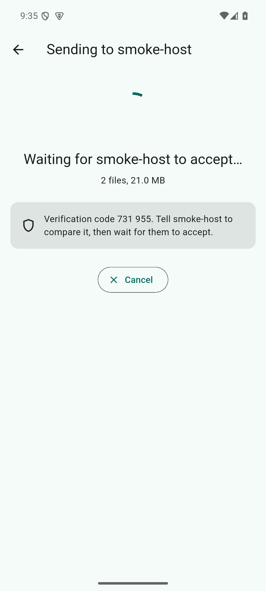
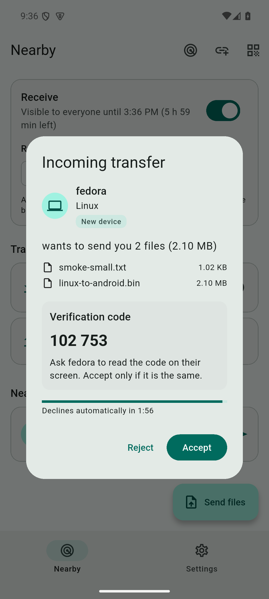

<div align="center">


# LibreShare

**High-speed, end-to-end encrypted, peer-to-peer file sharing for your local network and beyond.**

[](LICENSE)
[](#precompiled-downloads)
[](https://flutter.dev)
[](https://dart.dev)
[](#security--privacy)

[Downloads](#precompiled-downloads) • [Screenshots](#app-screenshots--file-transfer-flow) • [How It Works](#how-file-transfer-works) • [Quick Start](#quick-start) • [Architecture](#architecture--ladder)

</div>

---

## Overview

**LibreShare** is a free and open-source cross-platform file transfer tool built for Windows, Linux, and Android (with macOS best-effort). Devices on the same Wi-Fi or local area network automatically discover each other via multicast and mDNS.

Files are streamed directly peer-to-peer in **4 MiB chunks**, each cryptographically checked with **SHA-256**, allowing interrupted transfers to **resume immediately without re-downloading existing chunks**. When no direct local route exists, LibreShare automatically falls back to an end-to-end encrypted (AES-256-GCM) tunnel as a last resort.

The application combines a modern Flutter GUI with a pure-Dart core engine that speaks the **LSP/1** specification ([docs/protocol/LSP-1.md](docs/protocol/LSP-1.md)).

---

## App Screenshots & File Transfer Flow

Here is how passing files looks between devices in LibreShare:

<div align="center">

| 1. Sender Screen (Transferring & SAS Code) | 2. Receiver Screen (Verification & Consent) |
| :---: | :---: |
|  |  |
| *Real-time progress, dynamic speed, byte tracker, and 6-digit Short Authentication String (SAS)* | *Incoming transfer prompt, file manifest, sender details, and matching verification code* |

</div>

### Key Transfer Highlights
* **Zero Configuration:** Devices announce their presence automatically across local subnets using UDP 53318 multicast and mDNS.
* **Mutual Authentication:** Transfers use TLS 1.3 with peer certificate pinning and a matching **6-digit verification code (SAS)** to prevent man-in-the-middle attacks.
* **Progress & Resume:** Live transfer speeds, remaining time estimates, individual file progress bars, and automatic bitmap checkpointing for instant resume.
* **Receiver Consent:** The receiver gets a complete manifest of incoming filenames and sizes, requiring explicit acceptance before any data is written to disk.

---

## How File Transfer Works


---

## Precompiled Downloads

Ready-to-run releases are tracked directly in the [`builds/`](builds/) directory with verified SHA-256 checksums:

| Platform | Package | Architecture | Size | Installation / Run |
| :--- | :--- | :--- | :--- | :--- |
| **Android** | [`libreshare-1.0.0-android-arm64-v8a.apk`](builds/libreshare-1.0.0-android-arm64-v8a.apk) | ARM64 *(Recommended)* | ~29 MiB | `adb install -r libreshare-1.0.0-android-arm64-v8a.apk` |
| **Android** | [`libreshare-1.0.0-android-universal.apk`](builds/libreshare-1.0.0-android-universal.apk) | Universal (All Devices) | ~81 MiB | Direct APK install on Android 10+ |
| **Android** | [`libreshare-1.0.0-android-armeabi-v7a.apk`](builds/libreshare-1.0.0-android-armeabi-v7a.apk) | 32-bit ARM | ~25 MiB | Legacy Android devices |
| **Android** | [`libreshare-1.0.0-android-x86_64.apk`](builds/libreshare-1.0.0-android-x86_64.apk) | x86_64 | ~31 MiB | Emulators / ChromeOS |
| **Linux** | [`libreshare-1.0.0-linux-x64.tar.gz`](builds/libreshare-1.0.0-linux-x64.tar.gz) | x64 (GLIBC 2.31+) | ~11.5 MiB | Extract and run `./libreshare_app` |
| **Windows** | `libreshare-1.0.0-windows-x64.zip` | x64 (Windows 10/11) | ~18 MiB | Extract and run `libreshare_app.exe` |

*Verify all packages with: `cd builds && sha256sum -c SHA256SUMS`.*

---

## Quick Start

### 1. Run the Desktop App (Linux)
```bash
tar xzf builds/libreshare-1.0.0-linux-x64.tar.gz
cd libreshare-1.0.0-linux-x64
./libreshare_app
```
*Tip: Ensure UDP 53318 (discovery) and TCP 53317–53349 (transfer) are permitted on your local firewall.*

### 2. Run the Desktop App (Windows)
Unzip `builds/libreshare-1.0.0-windows-x64.zip` and run `libreshare_app.exe`. Alternatively, build from source on Windows:
```powershell
cd apps\libreshare_app
flutter build windows --release
```

### 3. Run the Command-Line Tool (CLI)
LibreShare ships with a full-featured standalone CLI:
```bash
source tools/env.sh

# Start receiving files into /tmp/downloads:
dart run packages/libreshare_cli/bin/ls.dart receive --dir /tmp/downloads --auto-accept

# Send files to a peer on another terminal or machine:
dart run packages/libreshare_cli/bin/ls.dart send document.pdf --to 192.168.1.50:53318
```

### 4. Headless Docker Node
Deploy a headless drop-box service on a home server or NAS:
```bash
# Linux
deploy/install.sh

# Windows / macOS (PowerShell)
powershell -ExecutionPolicy Bypass -File deploy\install.ps1
```

---

## Security & Privacy

LibreShare is architected with a **privacy-first, zero-trust** mindset:

* **Strict TLS 1.3 by Default:** All connections mandate TLS 1.3 with modern ephemeral cipher suites.
* **Certificate Pinning:** Every device creates and retains its own Ed25519/TLS identity certificate. Untrusted or modified keys trigger an alert.
* **6-Digit SAS Code:** Every transfer displays an out-of-band confirmation code computed from the cryptographic session binding.
* **Contacts-Only Mode:** Gate file reception strictly to previously paired contacts.
* **Safe Filesystem Sanitization:** All incoming filenames are rigorously sanitized against directory traversal attacks (`../`, hidden files, forbidden characters, ADS).
* **Zero Telemetry:** No user analytics, no tracking, and no external cloud servers required for local transfers.

---

## Architecture & Ladder

LibreShare prioritizes connections via a candidate ladder similar to ICE:

```
[WiFi Tier]   Direct connection over primary Wi-Fi / Hotspot interface
     │ (Fallback if blocked or routed differently)
     ▼
[LAN Tier]    Secondary interface, Ethernet, IPv6 link-local, or subnet scan
     │ (Fallback if cross-network or behind NAT)
     ▼
[Tunnel Tier] End-to-end encrypted AES-256-GCM via Cloudflare Quick Tunnel / zrok
```

### Repository Structure
```
.
├── apps/
│   └── libreshare_app/             Flutter GUI application (Linux, Windows, Android)
├── packages/
│   ├── libreshare_core/            Pure-Dart core (discovery, protocol, crypto, ladder)
│   └── libreshare_cli/             Terminal CLI utility (`ls.dart`)
├── builds/                         Precompiled release packages & checksums
├── docs/
│   ├── LIBRESHARE_BUILD_SPEC.md    System specifications and increment plans
│   ├── protocol/LSP-1.md           Normative LSP/1 wire protocol specifications
│   ├── images/                     Screenshots and application diagrams
│   └── dev/                        Developer setup and verification guides
└── tools/                          Build scripts, Docker test rigs, and benchmarks
```

---

## Development & Testing

Ensure you have Flutter 3.47.9 and Dart 3.13.7 (or run `source tools/env.sh`):

```bash
# 1. Resolve workspace dependencies
dart pub get

# 2. Run static analysis & formatting checks
dart analyze --fatal-infos
dart format --output=none --set-exit-if-changed .

# 3. Run core test suite (+2500 tests)
cd packages/libreshare_core && dart test

# 4. Run CLI test suite
cd packages/libreshare_cli && dart test

# 5. Run Flutter unit and widget tests
cd apps/libreshare_app && flutter test

# 6. Run 100 MiB loopback transfer smoke test
tools/loopback_smoke.sh 100 53400
```

---

## License

LibreShare is licensed under the [MIT License](LICENSE).
