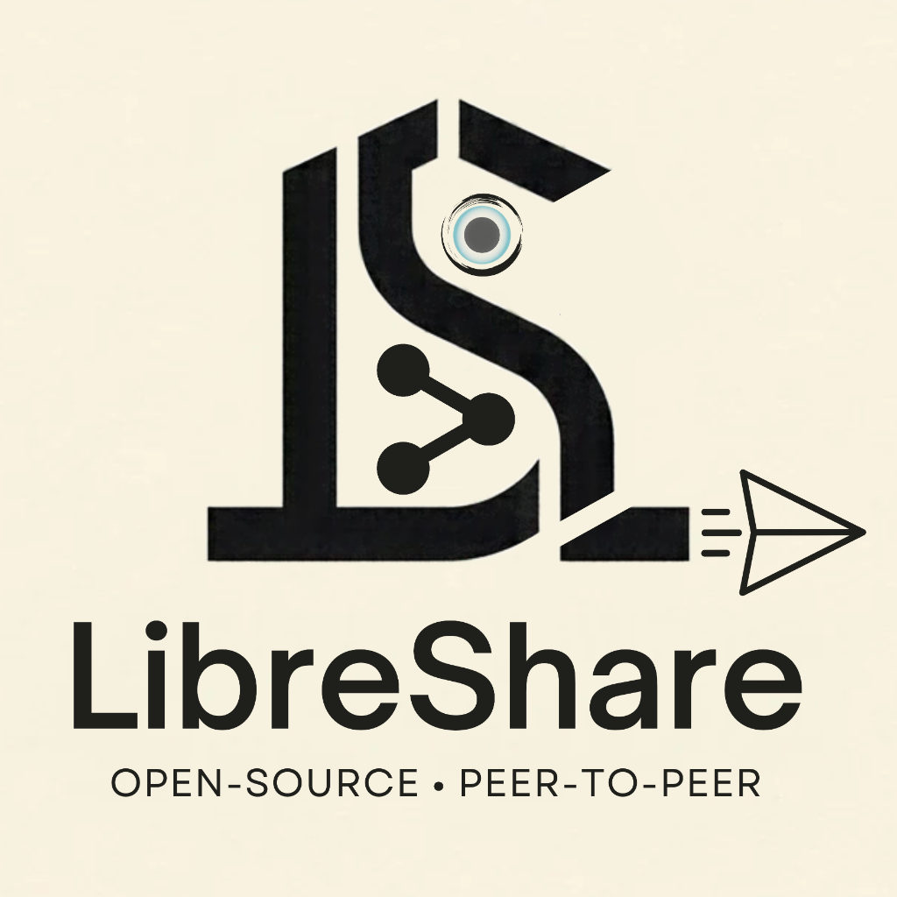
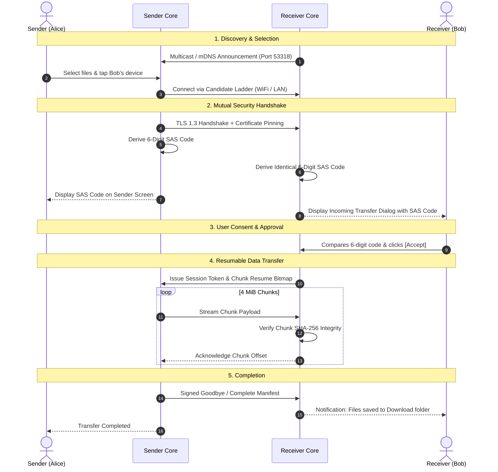

<div align="center">



# LibreShare

**Fast, end-to-end encrypted, peer-to-peer file sharing for your local network and beyond. No accounts. No cloud. No telemetry.**

[](LICENSE)
[](https://github.com/kirat11X/LibreShare/releases/latest)
[](#download)
[](https://flutter.dev)
[](https://dart.dev)
[](#security--privacy)

[Download](#download) • [What's New](#whats-new) • [Screenshots](#screenshots) • [Web Portal](#web-portal-zero-install-browser-sharing) • [How It Works](#how-it-works) • [Quick Start](#quick-start) • [Architecture](#architecture)

</div>

---

## Overview

LibreShare is a free, open-source file transfer app for Android, iOS, Linux, macOS, and Windows. Devices on the same Wi-Fi or LAN find each other automatically (UDP multicast + mDNS), and files stream directly between them: **no server in the middle**.

* **4 MiB chunks**, each verified with SHA-256. Interrupted transfers resume without re-sending finished chunks.
* **TLS 1.3 with certificate pinning** plus a 6-digit verification code (SAS) on every transfer to stop man-in-the-middle attacks.
* **Connection ladder**: Wi-Fi, then LAN, then an end-to-end encrypted (AES-256-GCM) tunnel when no direct route exists.
* **Zero-install Web Portal**: share with any phone or laptop that only has a browser.
* A Flutter UI on top of a pure-Dart core engine that speaks the open LSP/1 protocol ([spec](docs/protocol/LSP-1.md)).

---

## What's New

### November 2026
* **Web Portal (Browser Share)**: Send and receive files with any device that has a browser. Nothing to install on the other side. Scan a QR code, optionally protect it with a PIN, and drag-and-drop to upload or tap to download. Browsers can even install it as a PWA. Available in the app (home screen) and the CLI (`ls web`).
* **macOS and iOS builds, plus a Windows x64 package**: LibreShare now ships for all five major platforms from one codebase.
* **New branding**: App logo and icons across Android, iOS, macOS, Windows, and Linux.
* **Dual licensing**: GNU AGPLv3 for open-source use, commercial license available.
* **macOS fix**: Resolved a `libcrypto` load crash in the packaged app.

### Under the Hood (Core Engine)
* **Native SHA-256 via FFI** (OpenSSL `libcrypto` / Windows `bcrypt`, pure-Dart fallback). Hashing runs above 500 MiB/s.
* **Speed profiles**: `eco`, `balanced`, `turbo`.
* **Internet rendezvous** over Nostr and ntfy relays with BIP-340 Schnorr signatures, so two devices can find each other across networks without a central server.
* **NAT port mapping**: UPnP-IGD, NAT-PMP, and PCP, with hardened gateway handling.
* **Bluetooth LE + hotspot discovery** with rotating ephemeral IDs and an encrypted GATT handshake.
* **Tunnel crypto layer** (HKDF subkeys, AES-256-GCM) and share-link format. Live Cloudflare Quick Tunnel / zrok providers are still in progress.
* **3,000+ automated tests** across protocol conformance, fuzzing, security regressions, soak, and CLI end-to-end suites.
* Full history in [CHANGELOG.md](CHANGELOG.md).

---

## Download

Get the latest builds from the [Releases page](https://github.com/kirat11X/LibreShare/releases/latest).

| Platform | Package | Notes |
| :--- | :--- | :--- |
| **Android** | `libreshare-1.0.0-android-arm64-v8a.apk` | Recommended for most phones. Universal, armeabi-v7a and x86_64 APKs also available. Enable "Install unknown apps". |
| **iOS** | `libreshare-1.0.0-ios.ipa` | Unsigned. Sideload with AltStore, SideStore, Sideloadly or TrollStore. |
| **Linux** | `libreshare-1.0.0-linux-x64.tar.gz` | x64, GLIBC 2.31+. Extract and run `./libreshare_app`. |
| **macOS** | `libreshare-1.0.0-macos.zip` | Apple Silicon and Intel. Move `LibreShare.app` to `/Applications`. |
| **Windows** | `libreshare-1.0.0-windows-x64.zip` | Windows 10/11 x64. Extract and run `libreshare_app.exe`. |

*Verify any download with `sha256sum -c SHA256SUMS`.*

---

## Screenshots

<div align="center">

| 1. Sender (transfer + SAS code) | 2. Receiver (verification + consent) |
| :---: | :---: |
|  |  |
| *Live progress, speed, byte counter and 6-digit SAS code* | *Incoming prompt with file manifest, sender details and matching code* |

</div>

### Highlights
* **Zero configuration**: Devices announce themselves over UDP 53318 multicast and mDNS.
* **Mutual authentication**: TLS 1.3 + pinned certificates + matching 6-digit SAS.
* **Resume**: Bitmap checkpoints let a dropped transfer pick up where it stopped.
* **Receiver consent**: The receiver sees every filename and size and must accept before anything is written to disk.

---

## Web Portal (Zero-Install Browser Sharing)

Need to get a file to a device that doesn't have LibreShare? Turn on the Web Portal.

1. Open **Web Portal** from the home screen of the app (or run `ls web` in the CLI).
2. Scan the QR code with any phone or tablet on the same Wi-Fi, or open `http://<your-ip>:<port>/web`.
3. **Download**: Add files in the app and they appear in the browser, with resumable range downloads for big files.
4. **Upload**: Drag and drop (or pick) files in the browser and they land in your receive folder.
5. **Optional PIN** keeps other devices on the Wi-Fi out. Browsers can tap **Install App** to use it as a standalone PWA.

The portal is fully self-contained (no CDNs, works offline on local Wi-Fi). Uploads are sanitized against path traversal, name collisions are renamed instead of overwritten, and failed PIN attempts are rate-limited.

---

## How It Works



---

## Quick Start

### Android
Install the APK from [Releases](https://github.com/kirat11X/LibreShare/releases/latest), or with `adb install -r libreshare-1.0.0-android-arm64-v8a.apk`. Keep the app open and the screen on during transfers.

### Linux
```bash
tar xzf libreshare-1.0.0-linux-x64.tar.gz
cd libreshare-1.0.0-linux-x64
./libreshare_app
```
*Allow UDP 53318 (discovery) and TCP 53317–53349 (transfer) through your firewall.*

### Windows
Extract `libreshare-1.0.0-windows-x64.zip` and run `libreshare_app.exe`.
*(Build from source: `cd apps\libreshare_app && flutter build windows --release`)*

### macOS
Unzip, drag `LibreShare.app` to `/Applications`. The build is not notarized, so on first launch either right-click, Open, or run:
```bash
xattr -cr /Applications/LibreShare.app
```

### iOS (iPhone & iPad)
Sideload the unsigned IPA:
* **AltStore / SideStore**: Tap `+`, pick the IPA, enter your Apple ID.
* **Sideloadly**: Connect via USB, drag the IPA in, click Start.
* **TrollStore (iOS 14.0–17.0)**: Installs without 7-day re-signing.

### Command-Line Tool
```bash
source tools/env.sh

# Receive into /tmp/downloads:
dart run packages/libreshare_cli/bin/ls.dart receive --dir /tmp/downloads --auto-accept

# Send to a peer:
dart run packages/libreshare_cli/bin/ls.dart send document.pdf --to 192.168.1.50:53318

# Start the browser Web Portal:
dart run packages/libreshare_cli/bin/ls.dart web --help
```

### Headless Docker Node
A drop-box service for a home server or NAS:
```bash
# Linux
deploy/install.sh

# Windows (PowerShell)
powershell -ExecutionPolicy Bypass -File deploy\install.ps1
```

---

## Security & Privacy

* **TLS 1.3 only** with modern ephemeral cipher suites.
* **Certificate pinning**: Each device keeps its own identity certificate; an unexpected key change is refused and flagged.
* **6-digit SAS** derived from the cryptographic session binding, confirmed out of band.
* **Receiver PIN** (fixed or rotating) with brute-force rate limiting.
* **Contacts-only mode**: Unapproved peers get a 404, so the device is invisible to network scans.
* **Filename sanitization** against directory traversal, hidden files, reserved names and NTFS alternate data streams.
* **Log hygiene**: Keys, PINs, session tokens and tunnel fragments are never logged.
* **Zero telemetry**: No analytics, no tracking, no cloud servers for local transfers.

Found a vulnerability? See [SECURITY.md](SECURITY.md).

---

## Architecture

LibreShare picks a route with a candidate ladder, similar to ICE:

```
[Wi-Fi tier]     Direct over the primary Wi-Fi / hotspot interface
      │ (fallback: blocked or routed differently)
      ▼
[LAN tier]       Secondary interface, Ethernet, IPv6 link-local, subnet scan
      │ (fallback: cross-network or behind NAT)
      ▼
[Tunnel tier]    End-to-end encrypted AES-256-GCM tunnel
```

### Repository Layout

```
.
├── apps/
│   └── libreshare_app/      Flutter app (Android, iOS, Linux, macOS, Windows)
├── packages/
│   ├── libreshare_core/     Pure-Dart core: discovery, protocol, crypto, ladder, web portal
│   └── libreshare_cli/      Terminal client (ls.dart)
├── docs/
│   ├── protocol/            LSP/1 wire protocol, JSON schemas, test vectors
│   ├── adr/                 Architecture decision records
│   ├── design/              Feature design notes
│   ├── dev/                 Developer setup guides
│   └── user/guide.md        User guide
├── deploy/                  Docker and install scripts
└── tools/                   Build scripts, Docker test rigs, benchmarks
```

---

## Development & Testing

Requires Flutter 3.47.9 / Dart 3.13.7 (or `source tools/env.sh`).

```bash
dart pub get                                      # resolve workspace
dart analyze --fatal-infos                        # static analysis
dart format --output=none --set-exit-if-changed . # formatting check
(cd packages/libreshare_core && dart test)        # core tests
(cd packages/libreshare_cli && dart test)         # CLI tests
(cd apps/libreshare_app && flutter test)          # app tests
tools/loopback_smoke.sh 100 53400                 # 100 MiB loopback smoke test
```

Contributions are welcome: see [CONTRIBUTING.md](CONTRIBUTING.md).

---

## License

LibreShare is dual-licensed:

* **Open source (GNU AGPLv3)**: Free for personal and community use under the AGPLv3. Modified versions and derived network services must stay open under the same license.
* **Commercial license**: Closed-source, OEM and proprietary distribution rights are reserved by the copyright holder. Contact the author for a commercial license.
* **Trademarks**: "LibreShare" and the project logos are trademarks. Forks must rebrand.
