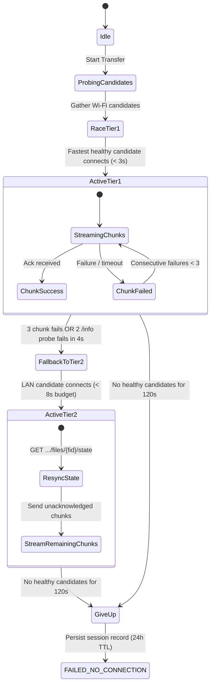
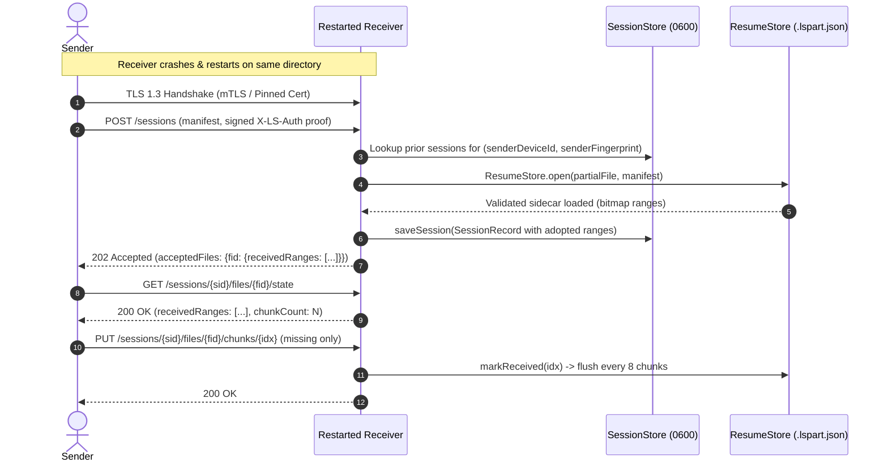

# Increment 4 — Integration Seams and Contracts (Wave 0 Architecture)

> ## ORCHESTRATOR CORRECTIONS (binding; written 2026-11-06 14:38:13 by `date`; they OVERRIDE everything below)
> The Lead drafted this document. The orchestrator reviewed it and adopts it **with these corrections**:
> 1. **Nothing has landed.** Section 2 says "Landed"; it means *drafted*. The five contract files exist only as drafts under `docs/plans/inc4-proposals/wave0/` (excluded from the analyzer); `connection/`, `monitor/` and `session/` in the real tree are still empty. The orchestrator reviews the drafts, writes/adopts their tests under `packages/libreshare_core/test/unit/`, applies them and then writes `INC4_WAVE0: APPLIED` in STATUS.md. Until then no card that needs them starts.
> 2. **`Connection` is wrong as drafted.** The ladder carries HTTP(S) requests, not raw bytes (ADR 0002: a tier is a path to the peer's mTLS HTTPS server; `PeerClient`/`SecurePeerClient` carry the protocol and the chunk/resume semantics are identical on every tier). The raw `send(List<int>)` / `receive()` API is REMOVED. Binding shape:
>    ```dart
>    abstract interface class Connection {
>      Candidate get candidate;
>      ConnectionState get state;
>      bool get isHealthy;
>      Duration? get latency;
>      /// Opens the path and returns a client bound to this candidate; on the secure profile the TLS
>      /// pin is candidate.peerFingerprint. A mismatch throws FingerprintMismatchException, the candidate is demoted and NEVER used.
>      Future<PeerClient> open({Duration? timeout});
>      Future<void> close();
>    }
>    ```
>    (`PeerClient` is the existing orchestrator-owned interface in `client/peer_client.dart`; the exception classes of section 3.2 stay.)
> 3. **Section 5, invariant 3 (PIN counters survive a restart) is NOT adopted.** It is an open user question (inc4.md Q3). Default for this increment: the counters stay in memory, the limit is documented. Invariants 1 and 2 stand.
> 4. **Constants (section 4).** Only numbers that exist in the spec/ADR 0002 are binding (3 s connect, 8 s tier budget, 3 consecutive chunk failures, 2 failed `/info` probes in 4 s, 120 s give-up, 24 h window). Every other number (`kTlsHandshakeTimeout`, `kChunkIdleTimeout`, ...) is "proposed": the tester lists it as such in tests-plan.md and no test pins it as normative.
> 5. **`Candidate.toJson/fromJson` is for local persistence and logs only.** It must not add a field to any LSP-1 message. A protocol change is made by the orchestrator (LSP-1.md + schemas + conformance together).
> 6. **Tests live in the real test tree**, written by testers from `inc4.md` section 4; the 27 draft tests under `docs/` are inputs, not acceptance tests. The "Definition of Done" block of section 6 is replaced by `inc4.md` section 9.
> 7. The Mermaid state machine is illustrative; the normative behaviour is `inc4.md` D4/D5/D6 and the tests.


Status: **WAVE 0 ARCHITECTURAL CONTRACTS READY (2026-11-06)**.  
Binding for: P4-1 (Bench/Gate), P4-2 (FaultyTcpProxy), P4-3 (SessionStore/EventLog), P4-4 (Hash Pipeline), P4-5 (Resume/Idle Timeout), P4-6 (Connection Layer), P4-7 (Engine/CLI Wiring), P4-8 (App Badge/History), P4-9 (Docker netem).  
Source references: `docs/plans/inc4.md`, `docs/adr/0002-connection-ladder-as-candidates.md`, `docs/test-reports/inc4-spikes.md`, `docs/protocol/LSP-1.md`.  
Source of truth for draft implementations: `docs/plans/inc4-proposals/wave0/`.

---

## 1. Rules That Apply to Every Increment 4 Package

1. **Plaintext Profile Compatibility:** Existing Increment 1/2/3 plaintext behaviour remains byte-for-byte compatible. All 2591+ core tests and existing CLI/app suites must continue to pass without modifications to existing tests or fixtures.
2. **Pinned Identity Continuity (Decision D6):** Every connection candidate carries the pinned `peerFingerprint`. A fallback candidate or tier switch MUST verify that the certificate presented during TLS handshake matches this fingerprint. Switching tiers NEVER bypasses identity verification and NEVER communicates with an unauthenticated or mismatched key.
3. **Zero Secret Leaks:** Persistent session records, channel events, logs, and exception strings MUST NEVER contain PINs, bearer tokens, private keys, or SAS nonces. All authentication is renewed on resume requests. Exceptions use fixed descriptive text and display fingerprints truncated to $\le 16$ hex characters (`shortFp`).
4. **Atomic Persistence & POSIX Permissions:** Session records in `SessionStore` must be written atomically (write to `<target>.tmp`, fsync/flush, rename) with POSIX mode `0600` on files and `0700` on storage directories.
5. **24-Hour TTL Eviction:** Inactive sessions and partial chunk sidecars expire after 24 hours (`kResumeWindow`). Expired records are deleted on access and during periodic sweeps.
6. **Isolated Deterministic Tests:** All timeouts and TTL evaluations must support injectable `Clock` (`package:libreshare_core/src/clock.dart`) to avoid wall-clock test flakes. Heavy integration tests run under `flock -o /tmp/libreshare-heavy.lock`.

---

## 2. Landed Wave 0 Contracts & Interface Seams

| Package / File Path | Architectural Seam | Responsible Work Package |
|---|---|---|
| `packages/libreshare_core/lib/src/connection/candidate.dart` | `CandidateKind` enum, `Candidate` model, priority sorting (`compareTo`), JSON wire codec, pin matching | P4-6 (Connection Layer) |
| `packages/libreshare_core/lib/src/connection/connection.dart` | `Connection` interface (`connect`, `send`, `receive`, `close`, `latency`, `isHealthy`), `ConnectionState`, `FingerprintMismatchException` | P4-6 (WiFi/LAN implementations) |
| `packages/libreshare_core/lib/src/monitor/channel_event.dart` | `sealed class ChannelEvent`: `ChannelActive`, `ChannelFailed`, `ChannelTierSwitched`, `ChannelCandidateTested` | P4-3 (EventLog), P4-8 (App UI) |
| `packages/libreshare_core/lib/src/storage/session_record.dart` | `SessionRecord`, `SessionFileRecord`, `SessionRole`, chunk bitmap ranges, `assertNoSecretKeys` validator | P4-3, P4-5 |
| `packages/libreshare_core/lib/src/storage/session_store.dart` | `SessionStore` interface, `FileSessionStore` (mode 0600 atomic JSON), `InMemorySessionStore`, `SessionStoreException` | P4-3 (Store implementation), P4-5 (Resume) |

---

## 3. Exact API Definitions & Contracts

### 3.1 Candidate Model (`connection/candidate.dart`)

```dart
enum CandidateKind {
  wifi('wifi', defaultCostHint: 10),
  lan('lan', defaultCostHint: 20),
  manual('manual', defaultCostHint: 30),
  loopback('loopback', defaultCostHint: 5),
  tunnel('tunnel', defaultCostHint: 100); // Reserved for Increment 5

  final String wire;
  final int defaultCostHint;
  bool get isLocal => this != CandidateKind.tunnel;
  static CandidateKind fromWire(String wire);
}

class Candidate implements Comparable<Candidate> {
  const Candidate({
    required this.id,
    required this.kind,
    required this.host,
    required this.port,
    required this.peerFingerprint,
    required this.costHint,
    this.lastSuccess,
    this.rtt,
  });

  factory Candidate.create({
    required CandidateKind kind,
    required String host,
    required int port,
    required String peerFingerprint,
    String? id,
    int? costHint,
    DateTime? lastSuccess,
    Duration? rtt,
  });

  final String id;
  final CandidateKind kind;
  final String host;
  final int port;
  final String peerFingerprint;
  final int costHint;
  final DateTime? lastSuccess;
  final Duration? rtt;

  /// Invariant: remote certificate MUST match peerFingerprint.
  bool matchesFingerprint(String presentedFingerprint);

  /// Priority comparator: costHint ASC -> lastSuccess DESC -> rtt ASC -> id ASC.
  @override
  int compareTo(Candidate other);

  Candidate copyWith({...});
  Map<String, Object?> toJson();
  factory Candidate.fromJson(Map<String, Object?> json);
}
```

### 3.2 Connection Interface (`connection/connection.dart`)

```dart
enum ConnectionState { disconnected, connecting, connected, closed, failed }

abstract interface class Connection {
  Candidate get candidate;
  ConnectionState get state;
  bool get isHealthy;
  Duration? get latency;

  Future<void> connect({Duration? timeout});
  Future<void> send(List<int> data);
  Stream<List<int>> receive();
  Future<void> close();
}

class ConnectionException implements Exception { ... }
class ConnectionTimeoutException extends ConnectionException { ... }
class FingerprintMismatchException extends ConnectionException {
  final String expectedFingerprint;
  final String presentedFingerprint;
}
```

### 3.3 Channel Events (`monitor/channel_event.dart`)

```dart
sealed class ChannelEvent {
  const ChannelEvent({required this.timestamp});
  final DateTime timestamp;
}

class ChannelActive extends ChannelEvent {
  final Candidate candidate;
  final String? sessionId;
  final Duration rtt;
}

class ChannelFailed extends ChannelEvent {
  final Candidate candidate;
  final String? sessionId;
  final String reason;
  final Object? error;
  final int consecutiveFailures;
}

class ChannelTierSwitched extends ChannelEvent {
  final String? sessionId;
  final Candidate? fromCandidate;
  final Candidate toCandidate;
  final String reason;
}

class ChannelCandidateTested extends ChannelEvent {
  final Candidate candidate;
  final bool success;
  final Duration? rtt;
  final String? error;
}
```

### 3.4 Session Persistence (`storage/session_store.dart` & `storage/session_record.dart`)

```dart
enum SessionRole { sender('sender'), receiver('receiver'); }

class SessionFileRecord {
  final String fileId;
  final String name;
  final int size;
  final int chunkSize;
  final int chunkCount;
  final String? sha256;
  final String? partialPath;
  final ChunkRanges receivedRanges;
  final bool isComplete;
  int get receivedChunkCount;
}

class SessionRecord {
  final String sessionId;
  final SessionRole role;
  final String peerDeviceId;
  final String peerFingerprint;
  final TransferStatus status;
  final FailureReason? failureReason;
  final List<SessionFileRecord> files;
  final int totalSize;
  final String? chosenCandidateId;
  final DateTime createdAt;
  final DateTime updatedAt;
  final Map<String, Object?> extraMetadata;

  bool isExpired(DateTime now, {Duration maxAge = const Duration(hours: 24)});
  Map<String, Object?> toJson();
  factory SessionRecord.fromJson(Map<String, Object?> json);
}

abstract interface class SessionStore {
  Future<void> init();
  Future<SessionRecord?> getSession(String sessionId);
  Future<void> saveSession(SessionRecord record);
  Future<void> deleteSession(String sessionId);
  Future<List<SessionRecord>> listSessions({SessionRole? role});
  Future<int> sweepExpired({Duration maxAge = const Duration(hours: 24)});
  Future<void> close();
}
```

---

## 4. Connection Ladder Protocol & State Machine



### Protocol Timings & Constants (Decision D4)

| Parameter | Value | Description |
|---|---|---|
| `kCandidateConnectTimeout` | $3\text{ s}$ | Maximum connection budget per candidate attempt |
| `kTierRaceBudget` | $8\text{ s}$ | Maximum window allocated to race same-tier candidates |
| `kTlsHandshakeTimeout` | $5\text{ s}$ | TLS handshake and pinned cert verification cap |
| `kChunkIdleTimeout` | $30\text{ s}$ | Socket idle threshold during chunk transfer |
| `kMaxConsecutiveChunkFailures` | $3$ | Threshold triggering tier fallback |
| `kProbeFailureThreshold` | $2\text{ in } 4\text{ s}$ | Failed `GET /info` probes triggering demotion |
| `kLadderGiveUpTimeout` | $120\text{ s}$ | Total ladder exhaustion time before `FAILED(NO_CONNECTION)` |
| `kResumeWindow` | $24\text{ hours}$ | Session state and sidecar retention window |

---

## 5. Receiver Restart & Partial File Adoption Flow (Spike S4-B)

When a receiver process crashes (`kill -9`) mid-transfer:



### Security Adoption Invariants
1. **Authenticated Fingerprint Match:** A restarted receiver checks `SessionStore` and only adopts `<name>.lspart` if the incoming request's authenticated certificate fingerprint matches the original session's `peerFingerprint`.
2. **Manifest Integrity:** If `size`, `chunkSize`, `chunkCount`, `sha256`, or `modified` differ, the partial file and sidecar are deleted and transfer starts from byte 0.
3. **PIN Continuity:** Restarting the receiver does not grant a fresh PIN attempt budget. Rate limits and lockout state persist across restarts.

---

## 6. Definition of Done for Wave 0 and Increment 4 Packages

From the workspace root (`cd "/home/kirat/coding/Software Engineering LibreShare" && source tools/env.sh`):

```bash
dart format --output=none --set-exit-if-changed .          # exit code 0
HOME=/tmp dart analyze --fatal-infos                       # exit code 0
dart test docs/plans/inc4-proposals/wave0/candidate_test.dart       # all pass
dart test docs/plans/inc4-proposals/wave0/session_store_test.dart   # all pass
grep -RnE "package:flutter|dart:ui" packages/libreshare_core/lib    # no match (exit code 1)
```
